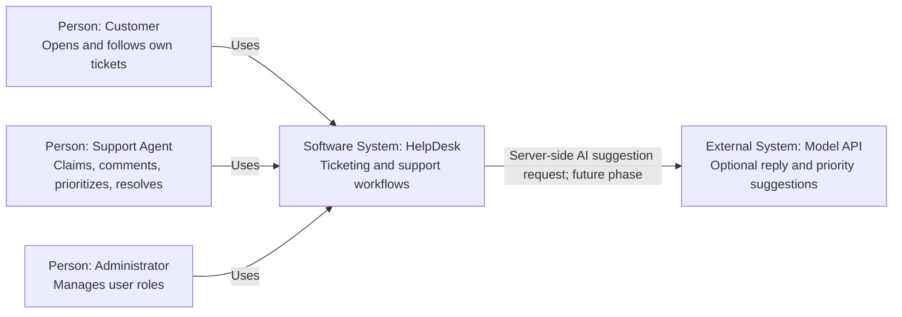
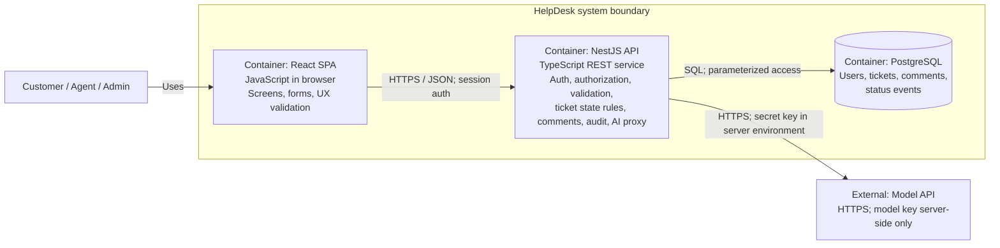

# HelpDesk — Architecture & Engineering Decisions

**Course:** AI-Assisted Software Engineering  |  **Deliverable:** Week 3  |  **Version:** 1.0  |  **Status:** Proposed architecture (not yet implemented)

## 1. Architectural drivers

We need a small but testable ticketing system with **customer ownership**, three roles, a controlled ticket **state machine**, an auditable discussion history, and a later AI suggestion feature. The design must remain understandable for an undergraduate semester project and secure even when a user bypasses the UI.

**Chosen design stack:** React (SPA), NestJS (TypeScript REST API), PostgreSQL, plus a future external Model API. This matches the Week-3 Persian lecture notes and the instructor's `code/example-architecture.md`. The system is **specified**, not yet built.

## 2. C4 Level 1 — System Context

*Level 1 purpose: show the software system as one box, its users, and its external dependency; internal frontend/database details do not appear here.*

**Interpretation:** The external AI system is a suggestion service, **not** a trusted ticket owner or an autonomous message sender. HelpDesk continues to work without it (NFR-06).

## 3. C4 Level 2 — Container Diagram

*Level 2 purpose: show separately running/deployable containers, communication direction and the important trust boundary.*

**Security boundary (non-negotiable):**

1. Browser -> **NestJS API only**. React never opens a DB connection or invokes the Model API directly.
2. All credential handling, role/ownership checks, input validation, state transitions, audit events, and secrets live on the backend.
3. PostgreSQL is reachable by the backend over a private connection. The model key is held only in backend environment configuration, not in `REACT_APP_*`, `VITE_*`, browser storage, or the Git repository.
4. Even if a user forges a browser request, the backend independently checks the authenticated role, requested ticket's owner/assignee, and allowed transition.
5. AI output is **untrusted text**: the API returns it as a draft for agent review, not a database mutation or automatic reply.

### Why must the browser not call the Model API directly?

A browser is controlled by its user: anyone can inspect its JavaScript, network requests and storage. If the model key were placed there, it could be copied and used to generate unauthorized requests and costs. An API middle layer hides the key, enforces authorization and rate limits, minimizes exposed ticket content and logs controlled model use. Similarly, a direct database connection from the browser would bypass ownership, role and validation rules.

## 4. Responsibility-placement table

| Concern | Owner/container | Why this placement is necessary | Trace to requirements |
|---|---|---|---|
| UI rendering, ticket forms, local field hints | React SPA | Immediate feedback and interaction; not a security authority | FR-02, FR-06 |
| Sign-in/session identity, password verification, current-role check | NestJS API | The browser cannot attest to a role; the server checks current privileges and keeps secrets server-side | FR-01, NFR-04 |
| Role-based authorization and owner/assignee checks | NestJS API | Apply on **every** direct HTTP call, not just after UI checks | FR-03, FR-05, FR-07, FR-10; NFR-02 |
| Input validation and response shaping | NestJS API (with optional UI hints) | Reject malformed IDs/payloads; never expose hash or private ticket columns | FR-02, FR-06; NFR-02 |
| Ticket state machine | NestJS Tickets service | One consistent decision point for transitions and `409` | FR-05, FR-07, FR-08 |
| Claim concurrency & atomic status/audit writes | NestJS Tickets service + PostgreSQL transaction | Prevent two assignees or status/event disagreement | FR-05, NFR-05 |
| Priority sorting and pagination | NestJS API + indexed PostgreSQL query | Deterministic order; bounded results with 10k rows | FR-04, FR-09; NFR-01 |
| Ticket/comment persistence | PostgreSQL, accessed via backend repository | Enforce foreign keys and durable storage | FR-02, FR-06, FR-11 |
| AI request, key, timeout, output filtering | NestJS AI service | No client-side secret; optional failure cannot break basic ticketing | FR-12, NFR-03, NFR-06 |
| Test suite and verification | Backend tests + CI, independent of AI | Objective evidence rather than trusting generated code | NFR-07 |

## 5. Inside the API — modular monolith (implementation plan)

This is **not** another deployable service layer: all modules run within the single NestJS API container.

| Internal module | Main responsibility |
|---|---|
| `AuthModule` / `UsersModule` | Session, password hashing, user roles, admin role updates |
| `TicketsModule` | Ticket creation, owner-limited access, queue, priority, assignment, status transition |
| `CommentsModule` | Ticket conversations with ticket-level access checks |
| `AuditModule` | Atomic status-change events and read-only history |
| `AiSuggestionsModule` (later) | Backend-only external Model API call, timeout, suggestion DTO; no auto-submit |

**Persistence sketch:** `users (1) -> (many) tickets via owner_id`; `users (0..1) -> (many) assigned tickets`; `tickets (1) -> (many) comments`; `tickets (1) -> (many) ticket_status_events`. All child entities have foreign keys. Indexes include `tickets(owner_id, created_at DESC)`, an index that supports **business priority rank** (`urgent > high > normal > low`) then `created_at ASC, id ASC`, and `comments(ticket_id, created_at)`. The queue must not sort priority strings alphabetically. A stored/generated numeric `priority_rank` or an equivalent query expression can implement this.

**Interaction sketch — self-assign ticket:**
1. Agent clicks **Claim**; React sends `POST /tickets/:id/claim` with authenticated session.
2. API validates role and ticket ID.
3. Within one DB transaction, API performs a conditional update only if `status=open AND assignee_id IS NULL`, writes `open -> in_progress` audit event, and commits.
4. If the conditional update affects zero rows, API returns `409` and the UI asks the agent to refresh.

**Interaction sketch — AI suggestion (later):** React sends `POST /tickets/:id/suggest` -> API authenticates the agent and authorizes ticket access -> API sends only necessary ticket content to Model API via server-held key -> API returns a **draft** -> agent chooses whether to edit and post it separately. A timeout fails just this optional action.

## 6. Scope cuts — three AI-suggested additions excluded from this design

During AI-assisted drafting, three additional features were proposed. The documented **MVP decision is to exclude** each one; the reasons below explain the cost and trade-off, rather than rejecting features only because of time.

| AI-suggested addition | Decision for this MVP | Engineering reason and trade-off |
|---|---|---|
| **Multi-tenancy** (multiple independent organizations) | **Exclude** | Every data access would need tenant isolation and cross-tenant security tests. A single-organization HelpDesk meets the capstone scope; multi-tenancy could be added after core authorization is tested. |
| **Automatically send AI-generated replies** | **Exclude** | Hallucinated or inappropriate replies could reach customers without review. Keep AI as a proposed priority + editable draft; a human agent explicitly approves sending. |
| **Real-time live chat with WebSockets** | **Exclude** | Adds connection management, event ordering and reconnection behavior. A persistent ticket-comment thread already meets the support communication requirement. |

Also, a single **modular monolith** is favored over microservices because there is no requirement for independently deployed services; this keeps authentication and transactions in one place.

## 7. AI-usage note — factual drafting and revision history

- **Where AI was used:** ChatGPT was used to draft the functional/non-functional requirements, acceptance criteria, C4 diagrams, responsibility-placement table and candidate scope cuts. This work was based on the Week-3 assignment (`project/README.md`), rubric (`project/RUBRIC.md`), Persian notes and reference examples.
- **What was checked and changed:** After the student requested a review, the generated material was compared against the instructor's requirements. A prior assistant explanation incorrectly suggested the Week-3 Persian materials used FastAPI; source review confirmed **NestJS**, and the final design consistently uses React + NestJS + PostgreSQL. The documents also make server-side authorization, the AI-key boundary, ownership checks, status transitions and measurable tests explicit. The final revision clarifies the agent/admin role permissions and specifies numeric priority ranking rather than sorting labels alphabetically.
- **What was not delegated to AI:** The architecture keeps ticket permissions, status updates, and actual customer-facing messages under server rules and human approval, rather than allowing a model to make unrestricted production changes.
- **Honest status:** These are design artifacts, not running software. No database migration, API implementation, performance measurement or end-to-end test has been performed as part of this Week-3 document submission. The student must understand and endorse the scope cuts and boundary rationale when submitting and defending the project.

## 8. Decision log / ADR-001

- **Decision (proposed):** a modular monolith: one React SPA, one NestJS API, one PostgreSQL database, and one optional external Model API integration (backend only).
- **Reason:** maximizes traceability and simplicity for a semester project while keeping strict security and ownership rules testable in one backend.
- **Trade-off:** initial deployment scales the API as a unit; acceptable for 10,000 ticket rows and small course-scale usage.
- **Review trigger:** measurable performance/load requirements change, a new organizational isolation requirement appears, or the course mandates a different backend stack.
- **Status:** Selected for the Week-3 design; implement and validate during subsequent coursework.

## 9. Week-4 architecture defense (30-second answer)

"The browser is not a trusted execution environment: users can inspect and modify its code and requests. Putting a model API key or database connection there would expose credentials and bypass ownership/role checks. Therefore React calls only our server API, which authenticates each request, enforces rules, accesses PostgreSQL with server-side credentials, and calls the model using a server-side key. The model supplies suggestions; an agent approves what is actually sent."
