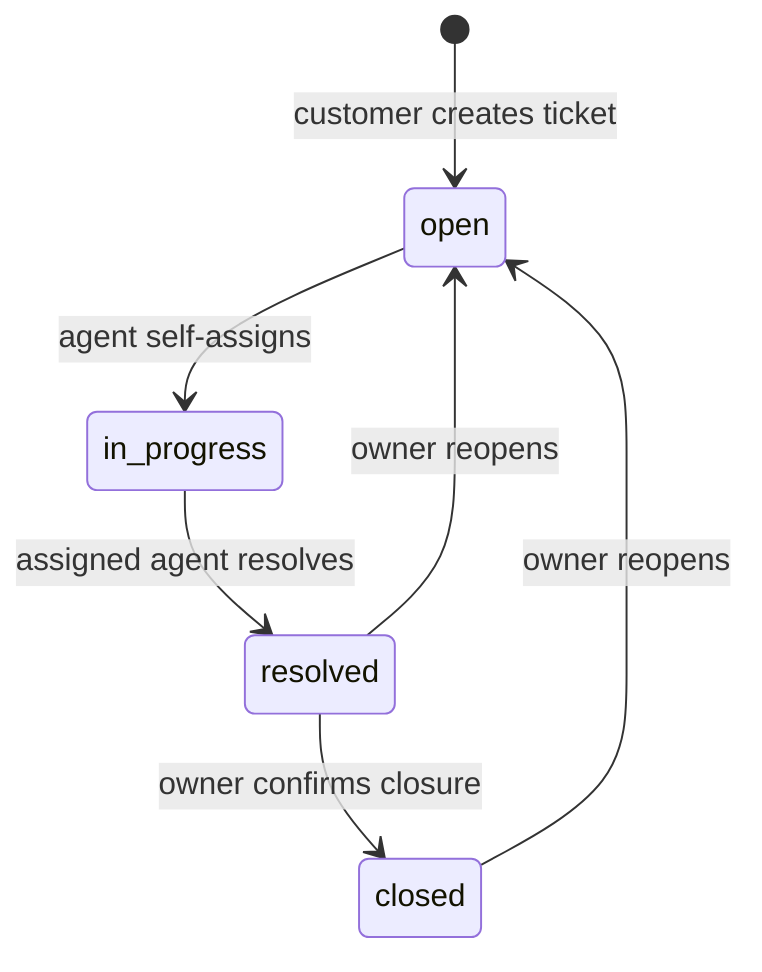

# HelpDesk — Requirements Specification

**Course:** AI-Assisted Software Engineering  |  **Deliverable:** Week 3  |  **Version:** 1.0  |  **Status:** Design specification (not yet implemented)

## 1. Problem, actors, and scope

HelpDesk is a **single-organization ticketing system**. Customers report a problem, support agents manage a shared queue and resolve tickets, and administrators manage user roles. All users authenticate before accessing tickets. The system keeps ticket ownership, status changes, and conversations consistent and auditable.

| Actor | Authorized capabilities |
|---|---|
| **Customer** | Create tickets, list/view **own** tickets, comment on own tickets, close a resolved ticket, and reopen own resolved/closed tickets. |
| **Agent** | View the shared support queue and ticket details, claim open tickets, set priority, comment on **assigned** tickets, and resolve **assigned** tickets. |
| **Admin** | Has support-staff ticket visibility/actions plus user-role management; status transitions and other business rules still apply. |
| **External Model API** | In a later phase, returns **suggested** priority and a response draft; it does **not** write ticket data or send messages on its own. |

### Definitions and domain contracts

- **Ticket owner**: the customer identified by `owner_id`; set server-side from the authenticated session, never from the submitted JSON.
- **Assignee**: a support agent identified by `assignee_id`, initially `null`.
- **Status**: one of `open`, `in_progress`, `resolved`, `closed`; created tickets start `open`.
- **Priority**: one of `low`, `normal`, `high`, `urgent`; defaults to `normal`.
- **Queue ordering**: `urgent > high > normal > low`, then `created_at` ascending, then `id` ascending to break ties. This is a **business-defined rank**, not alphabetical sorting of priority strings.
- **Comments**: readable by the ticket owner and support staff. Only the owner, the **assigned** agent, or an admin may post; no internal-only comment type in the MVP.
- **Authorization**: enforced **on every API request**, including requests made without the web UI.

### Ticket state machine

Every other status transition is invalid and must return `409 Conflict`. When the owner reopens a ticket, the assignee is cleared and the ticket returns to the unassigned queue. A status change and its audit event must be committed together.

## 2. Functional requirements (FR)

Each scenario is written as independently testable **Given / When / Then** acceptance criteria.

### FR-01 — Authenticate and identify role [Must]
**User story:** As a registered user, I want to sign in so I can access features allowed by my role.

- **Given** an active account with a valid password, **when** the user signs in, **then** the API establishes an authenticated session and subsequent requests identify the correct user ID and role.
- **Given** an invalid password or missing session, **when** the caller requests a protected ticket endpoint, **then** the API returns `401` and discloses no ticket data.

### FR-02 — Create a ticket [Must]
**User story:** As a customer, I want to submit a problem so support can work on it.

- **Given** an authenticated customer, **when** they submit a trimmed title (5–120 chars) and body (10–5000 chars), **then** one ticket is created with their authenticated ID as owner, `status=open`, `priority=normal`, `assignee_id=null`, and an immutable creation timestamp.
- **Given** an empty or out-of-range field, **when** they submit it, **then** the API returns `400` and creates no ticket.

### FR-03 — Enforce customer ticket ownership [Must]
**User story:** As a customer, I want to see my own tickets without exposing another customer's data.

- **Given** customers A and B and a ticket owned by A, **when** B calls either the ticket-list API or the ticket-detail API, **then** A's ticket is absent from B's list and the detail endpoint returns `404` without revealing content.
- **Given** customer A, **when** A lists tickets, **then** only tickets with `owner_id=A.id` are returned.

### FR-04 — Provide a prioritized agent queue [Must]
**User story:** As an agent, I want an ordered work queue so the most urgent, oldest problems appear first.

- **Given** an authenticated agent and tickets of different priorities and ages, **when** the agent requests the queue with `page=1&limit=20`, **then** at most 20 tickets are returned, ordered by priority descending and creation time ascending, with stable pagination metadata.
- **Given** a customer, **when** the customer requests the agent queue, **then** the API returns `403`.

### FR-05 — Self-assign an open ticket [Must]
**User story:** As an agent, I want to claim an available ticket so two agents do not unknowingly own the same work.

- **Given** an unassigned ticket in `open` state and agent A, **when** A claims the ticket, **then** the assignee becomes A and the status becomes `in_progress` in one transaction.
- **Given** two agents claim the same open ticket concurrently, **when** their requests are processed, **then** only one succeeds and the other receives `409`; the ticket has exactly one assignee.

### FR-06 — Add a ticket comment [Must]
**User story:** As an authorized participant, I want to discuss the issue in one chronological thread.

- **Given** the ticket owner or an authorized agent, **when** they submit a non-empty comment (1–3000 chars), **then** it is saved with the authenticated author ID and server-generated timestamp and shown oldest first.
- **Given** a different customer, **when** they attempt to read or post to that ticket's comments, **then** the API returns `404` and stores nothing.
- **Given** an agent who is not assigned to the ticket, **when** they attempt to post a comment, **then** the API returns `403` and stores nothing.

### FR-07 — Resolve an assigned ticket [Must]
**User story:** As the responsible agent, I want to mark solved issues as resolved.

- **Given** a ticket in `in_progress` assigned to agent A, **when** A chooses Resolve, **then** the status becomes `resolved`, the change is audited, and the owner sees the new status.
- **Given** an unassigned agent B or a ticket with a different status, **when** B requests Resolve, **then** the API returns `403` for insufficient permission or `409` for an invalid transition, without changing ticket data.

### FR-08 — Close or reopen own ticket [Must]
**User story:** As a customer, I want to confirm resolution or reopen a problem that persists.

- **Given** the owner and a `resolved` ticket, **when** the owner chooses Close, **then** the ticket becomes `closed` and an audit event is saved.
- **Given** the owner and a ticket in `resolved` or `closed`, **when** they choose Reopen, **then** it becomes `open`, `assignee_id` becomes `null`, and an audit event is saved.
- **Given** a ticket in `open` or `in_progress`, **when** someone attempts Close or Reopen, **then** the API rejects the transition with `409`.

### FR-09 — Set ticket priority [Must]
**User story:** As an agent, I want to set an issue's urgency to organize the queue.

- **Given** an authenticated agent and a visible ticket, **when** the agent sets priority to `low`, `normal`, `high`, or `urgent`, **then** the value is persisted and appears in the new queue order.
- **Given** a customer or an unsupported priority value, **when** they attempt to change priority, **then** the API rejects the request with `403` or `400`, respectively.

### FR-10 — Manage user roles [Must]
**User story:** As an administrator, I want to grant or revoke support permissions without letting users promote themselves.

- **Given** an admin and an existing user, **when** the admin updates the user's role to a supported value, **then** the new role is persisted and enforced on the user's next authenticated request (the server checks the current role instead of relying on a stale client-side claim).
- **Given** a customer or agent, **when** they attempt to change any role, **then** the API returns `403` and preserves the original role.

### FR-11 — View immutable status history [Should]
**User story:** As an authorized user, I want to see when a ticket moved between stages and who changed it.

- **Given** an owner or authorized support staff and a ticket with status transitions, **when** they read its history, **then** events show previous status, new status, actor ID, and timestamp ordered by occurrence.
- **Given** another customer, **when** they request that history, **then** the API returns `404`.

### FR-12 — Request an AI-assisted suggestion [Could; later course phase]
**User story:** As an agent, I want an optional suggested priority and response draft to save time while retaining editorial control.

- **Given** an authenticated agent with access to a ticket, **when** they request Suggest, **then** the **backend** calls the external model and returns a suggested priority and editable draft, **without** changing priority or adding a comment.
- **Given** that the model request fails or times out, **when** the suggestion is requested, **then** the API returns a controlled error and ordinary ticket operations continue normally.
- **Given** an AI draft, **when** the agent does not explicitly submit a comment, **then** no AI-generated text is posted to the customer.

## 3. Non-functional requirements (NFR)

Each NFR states the measurement environment and a pass/fail outcome.

### NFR-01 — Queue response time [Performance; Must]
- **Given** staging PostgreSQL seeded with 10,000 tickets, appropriate indexes, and one authenticated agent, **when** the first page of 20 queue items is requested 100 times after warm-up, **then** at least 95 responses complete within **1,000 ms**, excluding client-side rendering; record the measured p95.

### NFR-02 — Server-side authorization [Security; Must]
- **Given** an automated HTTP test suite calling protected APIs directly (not through React), **when** a customer attempts to list another owner's tickets, claim a ticket, update priority, or change roles, **then** every call is denied as specified by FR-03/04/05/09/10 and no protected data or state change occurs.

### NFR-03 — Protect credentials and network boundaries [Security; Must]
- **Given** a production build and a running deployment, **when** the browser bundle and network traffic are inspected, **then** no database connection string or model API key appears in frontend code or responses; browser-side ticket/data requests target the HelpDesk API only; server-side secrets are read from environment configuration; public requests use HTTPS.

### NFR-04 — Password safety [Security; Must]
- **Given** a user account is created or its password is changed, **when** the database and application logs are inspected, **then** no plaintext password is present; only a **bcrypt hash with cost >= 12** is stored. Invalid passwords do not authenticate.

### NFR-05 — Status audit integrity [Reliability/Auditability; Must]
- **Given** any successful status transition, **when** ticket state and audit history are queried, **then** exactly one audit event with actor, from-status, to-status, and timestamp exists; if the transaction fails, neither the status nor the audit event is committed.

### NFR-06 — Graceful model failure [Reliability; Should for AI phase]
- **Given** the external Model API is unavailable for more than **3 seconds**, **when** an agent requests an AI suggestion, **then** that request ends with an explicit unavailable response within **5 seconds**, and create/list/comment/resolve endpoints remain operational.

### NFR-07 — Reproducible checks [Maintainability; Must]
- **Given** a clean project checkout with dependencies installed and a test database configured, **when** CI runs linting, TypeScript checking, and backend automated tests, **then** all commands exit with code `0`; the suite includes at least one ownership test and one invalid-transition test.

## 4. Proposed system data & API contract (planning, not a substitute for tests)

| Entity | Minimum fields |
|---|---|
| `users` | `id`, `email` (unique), `password_hash`, `role`, `created_at` |
| `tickets` | `id`, `owner_id`, `assignee_id?`, `title`, `body`, `status`, `priority`, `created_at`, `updated_at` |
| `comments` | `id`, `ticket_id`, `author_id`, `body`, `created_at` |
| `ticket_status_events` | `id`, `ticket_id`, `actor_id`, `from_status`, `to_status`, `occurred_at` |

Candidate REST endpoints: `POST /auth/login`; `POST /tickets`; `GET /tickets`; `GET /tickets/:id`; `GET /agent/queue`; `POST /tickets/:id/claim`; `POST /tickets/:id/comments`; `POST /tickets/:id/resolve`; `POST /tickets/:id/close`; `POST /tickets/:id/reopen`; `PATCH /tickets/:id/priority`; `PATCH /admin/users/:id/role`; `GET /tickets/:id/history`; future `POST /tickets/:id/suggest`.

## 5. Scope and priorities (MoSCoW)

- **Must:** FR-01 through FR-10; NFR-01 through NFR-05 and NFR-07.
- **Should:** FR-11; NFR-06 once AI integration is added.
- **Could (later phase):** FR-12 AI-assisted, human-approved suggestion.
- **Won't in MVP:** multi-tenant organizations, automatic AI replies, and live chat. These AI-proposed additions are deliberately excluded from this design, with reasons in `architecture.md`.

## 6. Verification examples / traceability

| Requirement | Automated check |
|---|---|
| FR-03 / NFR-02 | Customer B requests Customer A's ticket; result `404`, zero leakage. |
| FR-05 | Concurrent claim test; exactly one request succeeds. |
| FR-07 / FR-08 | Reject `open -> closed` with `409`; resolve/reopen creates event. |
| FR-09 | Mixed-priority fixture; stable expected queue ordering. |
| FR-12 / NFR-06 | Stub the Model API to time out; no ticket mutation. |
| NFR-01 | 10,000-row staging seed and recorded p95 response time. |
| NFR-03 | Inspect built frontend artifacts and browser network calls for secrets/direct API use. |

> **Implementation status:** These are testable design contracts, not claims that the application or automated tests already exist. Acceptance criteria must be verified during later development.
